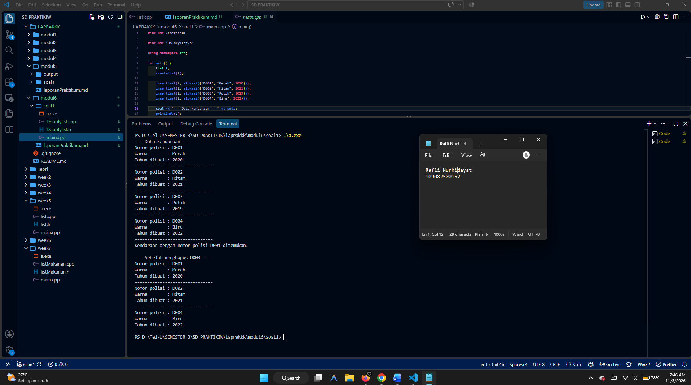

<div align="center">

# **Laporan Praktikum Modul 6 - Doubly Linked List (Bagian Pertama)**

Rafli Nurhidayat - 109082500152

</div>

## Dasar Teori

Linked list merupakan struktur data linear yang terdiri atas node-node yang
saling terhubung menggunakan pointer. Setiap node menyimpan data dan alamat
node lain. Berbeda dengan array, linked list menggunakan alokasi memori
dinamis sehingga jumlah elemennya dapat berubah selama program berjalan [1].

### A. Doubly Linked List

Doubly linked list adalah linked list yang setiap elemennya memiliki dua
pointer, yaitu `next` dan `prev`. Pointer `next` menunjuk node sesudahnya,
sedangkan pointer `prev` menunjuk node sebelumnya. Dengan demikian, list dapat
ditelusuri dari awal ke akhir maupun dari akhir ke awal.

Struktur list memiliki dua pointer utama:

1. **First**, menunjuk node pertama dalam list.
2. **Last**, menunjuk node terakhir dalam list.

Pada node, `next` milik node terakhir dan `prev` milik node pertama bernilai
`Nil`. Kondisi tersebut menjadi batas ketika list ditelusuri.

### B. Operasi Insert

Penyisipan pada doubly linked list dilakukan dengan memperbarui hubungan dua
arah. `insertFirst` menghubungkan node baru dengan `first`, sedangkan
`insertLast` menghubungkan node baru dengan `last`. `insertAfter` menyisipkan
node sesudah node tertentu dan `insertBefore` menyisipkan node sebelum node
tertentu.

Setiap operasi insert harus memperbarui pointer `next` dan `prev` pada node
yang terlibat. Jika list kosong, `first` dan `last` harus menunjuk node yang
sama.

### C. Operasi Delete

Penghapusan node juga harus memperbaiki hubungan dua arah sebelum memori node
didealokasi. `deleteFirst` menghapus node yang ditunjuk `first`, sedangkan
`deleteLast` menghapus node yang ditunjuk `last`. `deleteAfter` dan
`deleteBefore` menghapus node relatif terhadap node tertentu.

Jika node yang dihapus adalah satu-satunya node, `first` dan `last` diatur
menjadi `Nil`. Setelah node dihapus, pointer yang tidak lagi digunakan harus
diputus agar struktur list tetap valid.

### D. Searching, Update, dan View

Searching dilakukan dengan menelusuri node menggunakan `next` atau `prev`.
Pada doubly linked list, pencarian dapat dilakukan dari arah depan maupun
belakang. Operasi update mengubah data pada node yang sudah ditemukan,
sedangkan view menampilkan informasi setiap node.

### E. Alokasi dan Dealokasi Memori

Node dibuat secara dinamis dengan `new` melalui fungsi `alokasi`. Setelah node
tidak digunakan, memori dikembalikan menggunakan `delete` melalui fungsi
`dealokasi`. Pengelolaan memori yang benar mencegah memory leak dan dangling
pointer [2][3].

### F. Kompleksitas Operasi

Penyisipan atau penghapusan pada awal maupun akhir list dapat dilakukan dalam
`O(1)` jika pointer `first` dan `last` tersedia. Searching berdasarkan data
memerlukan penelusuran node sehingga kompleksitas waktunya `O(n)`. Doubly
linked list menggunakan memori lebih besar daripada singly linked list karena
setiap node menyimpan dua pointer.

## Guided

### 1. Source Code Guided

**`listMakanan.h`**

```cpp
#ifndef LISTMAKANAN_H
#define LISTMAKANAN_H
#define Nil NULL

#include <iostream>
using namespace std;

struct makanan
{
    string nama;
    string jenis;
    float harga;
    float rating;
};

typedef makanan dataMakanan;

typedef struct node *address;

struct node
{
    dataMakanan isidata;
    address next;
    address prev;
};

struct linkedlist
{
    address first;
    address last;
};

bool isEmpty(linkedlist List);
void createList(linkedlist &List);
address alokasi(string nama, string jenis, float harga, float rating);
void dealokasi(address &node);

void insertFirst(linkedlist &List, address nodeBaru);
void insertLast(linkedlist &List, address nodeBaru);
void insertAfter(linkedlist &List, address nodeBaru, address Prev);
void insertBefore(linkedlist &List, address nodeBaru, address nodeNext);

void printList(linkedlist List);

void updateFirst(linkedlist List);
void updateLast(linkedlist List);
void updateAfter(linkedlist List, address prev);
void updateBefore(linkedlist List, address nodeNext);

// Searching
void findByName(linkedlist List, string nama);
void findByJenis(linkedlist List, string jenis);
void findByMinRating(linkedlist List, float minRating);

// Delete
void deleteFirst(linkedlist &List);
void deleteLast(linkedlist &List);
void deleteAfter(linkedlist &List, address Prev);
void deleteBefore(linkedlist &List, address nodeNext);

void deleteNode(linkedlist &List, address target);
void deleteByName(linkedlist &List, string nama);

#endif
```

**`listMakanan.cpp`**

```cpp
#include "listMakanan.h"
#include <iostream>
#include <string>
using namespace std;

bool isEmpty(linkedlist List)
{
    if (List.first == Nil)
    {
        return true;
    }
    else
    {
        return false;
    }
}

void createList(linkedlist &List)
{
    List.first = Nil;
    List.last = Nil;
}

// pembuatan node baru dengan menerapkan manajemen memori
address alokasi(string nama, string jenis, float harga, float rating)
{
    address nodeBaru = new node;
    nodeBaru->isidata.nama = nama;
    nodeBaru->isidata.jenis = jenis;
    nodeBaru->isidata.harga = harga;
    nodeBaru->isidata.rating = rating;
    nodeBaru->next = Nil;
    nodeBaru->prev = Nil;
    return nodeBaru;
}

void dealokasi(address &node)
{
    node->next = Nil;
    node->prev = Nil;
    delete node;
}

void insertFirst(linkedlist &List, address nodeBaru)
{
    if (isEmpty(List))
    {
        List.first = List.last = nodeBaru;
    }
    else
    {
        nodeBaru->next = List.first;
        List.first->prev = nodeBaru;
        List.first = nodeBaru;
    }
    cout << "Node " << nodeBaru->isidata.nama << " berhasil ditambahkan sebagai node pertama list" << endl;
}

void insertLast(linkedlist &List, address nodeBaru)
{
    if (isEmpty(List) == true)
    {
        List.first = List.last = nodeBaru;
    }
    else
    {
        nodeBaru->prev = List.last;
        List.last->next = nodeBaru;
        List.last = nodeBaru;
    }
    cout << "Node " << nodeBaru->isidata.nama << " berhasil ditambahkan sebagai node terakhir list" << endl;
}

void insertAfter(linkedlist &List, address nodeBaru, address nodePrev)
{
    if (isEmpty(List) == true)
    {
        List.first = List.last = nodeBaru;
    }
    else
    {
        if (nodePrev != Nil)
        {
            if (nodePrev == List.last)
            {
                insertLast(List, nodeBaru);
            }
            else
            {
                nodeBaru->next = nodePrev->next;
                nodeBaru->prev = nodePrev;
                (nodePrev->next)->prev = nodeBaru;
                nodePrev->next = nodeBaru;
                cout << "Node " << nodeBaru->isidata.nama << " berhasil ditambahkan setelah node " << nodePrev->isidata.nama << endl;
            }
        }
        else
        {
            cout << "node sebelumnya (nodePrev) tidak valid!" << endl;
        }
    }
}

void insertBefore(linkedlist &List, address nodeBaru, address nodeNext)
{
    if (isEmpty(List) == true)
    {
        List.first = List.last = nodeBaru;
    }
    else
    {
        if (nodeNext != Nil)
        {
            if (nodeNext == List.first)
            {
                insertFirst(List, nodeBaru);
            }
            else
            {
                nodeBaru->next = nodeNext;
                nodeBaru->prev = nodeNext->prev;
                (nodeNext->prev)->next = nodeBaru;
                nodeNext->prev = nodeBaru;
                cout << "Node " << nodeBaru->isidata.nama << " berhasil ditambahkan sebelum node " << nodeNext->isidata.nama << endl;
            }
        }
        else
        {
            cout << "node setelahnya (nodeNext) tidak valid!" << endl;
        }
    }
}

void printList(linkedlist List)
{
    if (isEmpty(List) == true)
    {
        cout << "List kosong!" << endl;
    }
    else
    {
        address nodeBantu = List.first;
        while (nodeBantu != Nil)
        {
            cout << "Nama makanan : " << nodeBantu->isidata.nama << endl;
            cout << "Jenis        : " << nodeBantu->isidata.jenis << endl;
            cout << "Harga        : " << nodeBantu->isidata.harga << endl;
            cout << "Rating       : " << nodeBantu->isidata.rating << endl;
            cout << "-------------------------------" << endl;
            nodeBantu = nodeBantu->next;
        }
    }
}

void updateFirst(linkedlist List)
{
    if (isEmpty(List) == true)
    {
        cout << "List kosong!" << endl;
    }
    else
    {
        cout << "Masukkan update data node pertama : " << endl;
        cout << "Nama makanan : ";
        getline(cin, List.first->isidata.nama);
        cout << "Jenis makanan : ";
        getline(cin, List.first->isidata.jenis);
        cout << "Harga : ";
        cin >> List.first->isidata.harga;
        cout << "Rating : ";
        cin >> List.first->isidata.rating;
        cin.ignore(); // menghapus karakter newline (/n) dari input buffer
        cout << "Data Berhasil Diupdate!" << endl;
        cout << endl;
    }
}

void updateLast(linkedlist List)
{
    if (isEmpty(List) == true)
    {
        cout << "List kosong!" << endl;
    }
    else
    {
        cout << "Masukkan update data node terakhir : " << endl;
        cout << "Nama makanan : ";
        getline(cin, List.last->isidata.nama);
        cout << "Jenis makanan : ";
        getline(cin, List.last->isidata.jenis);
        cout << "Harga : ";
        cin >> List.last->isidata.harga;
        cout << "Rating : ";
        cin >> List.last->isidata.rating;
        cin.ignore(); // menghapus karakter newline (/n) dari input buffer
        cout << "Data Berhasil Diupdate!" << endl;
        cout << endl;
    }
}

void updateAfter(linkedlist List, address nodePrev)
{
    if (isEmpty(List) == true)
    {
        cout << "List kosong!" << endl;
    }
    else
    {
        if (nodePrev != Nil && nodePrev->next != Nil)
        {
            address nodeBantu = nodePrev->next;
            cout << "masukkan update data node setelah node " << nodePrev->isidata.nama << " : " << endl;
            cout << "Nama makanan : ";
            getline(cin, nodeBantu->isidata.nama);
            cout << "Jenis makanan : ";
            getline(cin, nodeBantu->isidata.jenis);
            cout << "Harga : ";
            cin >> nodeBantu->isidata.harga;
            cout << "Rating : ";
            cin >> nodeBantu->isidata.rating;
            cin.ignore(); // menghapus karakter newline (/n) dari input buffer
            cout << "Data Berhasil Diupdate!" << endl;
            cout << endl;
        }
        else
        {
            cout << "Node sebelumnya (nodePrev) tidak valid!" << endl;
        }
    }
}

void updateBefore(linkedlist List, address nodeNext)
{
    if (isEmpty(List) == true)
    {
        cout << "List kosong!" << endl;
    }
    else
    {
        if (nodeNext != Nil && nodeNext->prev != Nil)
        {
            address nodeBantu = nodeNext->prev;
            cout << "masukkan update data node sebelum node " << nodeNext->isidata.nama << " : " << endl;
            cout << "Nama makanan : ";
            getline(cin, nodeBantu->isidata.nama);
            cout << "Jenis makanan : ";
            getline(cin, nodeBantu->isidata.jenis);
            cout << "Harga : ";
            cin >> nodeBantu->isidata.harga;
            cout << "Rating : ";
            cin >> nodeBantu->isidata.rating;
            cin.ignore(); // menghapus karakter newline (/n) dari input buffer
            cout << "Data Berhasil Diupdate!" << endl;
            cout << endl;
        }
        else
        {
            cout << "Node sebelumnya (prev) tidak valid!" << endl;
        }
    }
}

// SEARCHING
void findByName(linkedlist List, string nama)
{
    if (isEmpty(List))
    {
        cout << "List kosong!" << endl;
        return;
    }
    address p = List.first;
    while (p != Nil)
    {
        if (p->isidata.nama == nama)
        {
            cout << "Ditemukan (berdasarkan nama):" << endl;
            cout << "Nama makanan : " << p->isidata.nama << endl;
            cout << "Jenis        : " << p->isidata.jenis << endl;
            cout << "Harga        : " << p->isidata.harga << endl;
            cout << "Rating       : " << p->isidata.rating << endl;
            return;
        }
        p = p->next;
    }
    cout << "Data dengan nama \"" << nama << "\" tidak ditemukan." << endl;
}

void findByJenis(linkedlist List, string jenis)
{
    if (isEmpty(List))
    {
        cout << "List kosong!" << endl;
        return;
    }
    address p = List.last;
    while (p != Nil)
    {
        if (p->isidata.jenis == jenis)
        {
            cout << "Ditemukan (berdasarkan jenis):" << endl;
            cout << "Nama makanan : " << p->isidata.nama << endl;
            cout << "Jenis        : " << p->isidata.jenis << endl;
            cout << "Harga        : " << p->isidata.harga << endl;
            cout << "Rating       : " << p->isidata.rating << endl;
            return;
        }
        p = p->prev;
    }
    cout << "Data dengan jenis \"" << jenis << "\" tidak ditemukan." << endl;
}

void findByMinRating(linkedlist List, float minRating)
{
    if (isEmpty(List))
    {
        cout << "List kosong!" << endl;
        return;
    }
    address p = List.last;
    while (p != Nil)
    {
        if (p->isidata.rating >= minRating)
        {
            cout << "Ditemukan (rating >= " << minRating << "):" << endl;
            cout << "Nama makanan : " << p->isidata.nama << endl;
            cout << "Jenis        : " << p->isidata.jenis << endl;
            cout << "Harga        : " << p->isidata.harga << endl;
            cout << "Rating       : " << p->isidata.rating << endl;
            return;
        }
        p = p->prev;
    }
    cout << "Tidak ada data dengan rating >= " << minRating << "." << endl;
}

// DELETE
void deleteFirst(linkedlist &List)
{
    if (isEmpty(List) == true)
    {
        cout << "List kosong! Tidak ada node yang dihapus." << endl;
        return;
    }
    address pDel = List.first;
    if (List.first == List.last)
    {
        List.first = List.last = Nil;
    }
    else
    {
        List.first = pDel->next;
        List.first->prev = Nil;
        pDel->next = Nil;
    }
    pDel->prev = Nil;
    cout << "Node " << pDel->isidata.nama << " berhasil dihapus dari posisi pertama." << endl;
    dealokasi(pDel);
}

void deleteLast(linkedlist &List)
{
    if (isEmpty(List) == true)
    {
        cout << "List kosong! Tidak ada node yang dihapus." << endl;
        return;
    }
    address pDel = List.last;
    if (List.first == List.last)
    {
        List.first = List.last = Nil;
    }
    else
    {
        List.last = pDel->prev;
        List.last->next = Nil;
        pDel->prev = Nil;
    }
    pDel->next = Nil;
    cout << "Node " << pDel->isidata.nama << " berhasil dihapus dari posisi terakhir." << endl;
    dealokasi(pDel);
}

void deleteAfter(linkedlist &List, address Prev)
{
    if (isEmpty(List) == true)
    {
        cout << "List kosong! Tidak ada node yang dihapus." << endl;
        return;
    }
    if (Prev == Nil || Prev->next == Nil)
    {
        cout << "Node sebelumnya (Prev) tidak valid atau tidak ada node setelahnya!" << endl;
        return;
    }
    if (Prev->next == List.last)
    {
        deleteLast(List);
        return;
    }
    address pDel = Prev->next;
    Prev->next = pDel->next;
    pDel->next->prev = Prev;
    pDel->prev = Nil;
    pDel->next = Nil;
    cout << "Node " << pDel->isidata.nama << " berhasil dihapus setelah node " << Prev->isidata.nama << "." << endl;
    dealokasi(pDel);
}

void deleteBefore(linkedlist &List, address nodeNext)
{
    if (isEmpty(List) == true)
    {
        cout << "List kosong! Tidak ada node yang dihapus." << endl;
        return;
    }
    if (nodeNext == Nil || nodeNext->prev == Nil)
    {
        cout << "Node setelahnya (nodeNext) tidak valid atau tidak ada node sebelumnya!" << endl;
        return;
    }
    if (nodeNext->prev == List.first)
    {
        deleteFirst(List);
        return;
    }
    address pDel = nodeNext->prev;
    nodeNext->prev = pDel->prev;
    pDel->prev->next = nodeNext;
    pDel->next = Nil;
    pDel->prev = Nil;
    cout << "Node " << pDel->isidata.nama << " berhasil dihapus sebelum node " << nodeNext->isidata.nama << "." << endl;
    dealokasi(pDel);
}

void deleteNode(linkedlist &List, address target)
{
    if (isEmpty(List) == true || target == Nil)
    {
        cout << "Target tidak valid atau list kosong!" << endl;
        return;
    }
    if (target == List.first)
    {
        deleteFirst(List);
    }
    else if (target == List.last)
    {
        deleteLast(List);
    }
    else
    {
        address L = target->prev;
        address R = target->next;
        L->next = R;
        R->prev = L;
        target->next = Nil;
        target->prev = Nil;
        cout << "Node " << target->isidata.nama << " berhasil dihapus dari tengah list." << endl;
        dealokasi(target);
    }
}

void deleteByName(linkedlist &List, string nama)
{
    if (isEmpty(List))
    {
        cout << "List kosong! Tidak ada node yang dihapus." << endl;
        return;
    }

    address target = List.first;
    while (target != Nil && target->isidata.nama != nama)
    {
        target = target->next;
    }
    if (target == Nil)
    {
        cout << "Node dengan nama \"" << nama << "\" tidak ditemukan." << endl;
        return;
    }

    deleteNode(List, target);
    cout << "Node dengan nama \"" << nama << "\" telah dihapus dan didealokasi." << endl;
}
```

**`main.cpp`**

```cpp
#include "listMakanan.h"
#include <iostream>

using namespace std;

int main()
{
    linkedlist List;
    address nodeA, nodeB, nodeC, nodeD, nodeE = Nil;
    createList(List);

    dataMakanan dtMakanan;

    nodeA = alokasi("Nasi Rames", "Makanan Berat", 10000, 8.5);
    nodeB = alokasi("Ayam Geprek", "Makanan Berat", 13000, 9.0);
    nodeC = alokasi("Risol Mayo", "Makanan Ringan", 3500, 8.8);
    nodeD = alokasi("Mie Ayam", "Makanan Berat", 15000, 9.9);
    nodeE = alokasi("Donat", "Makanan Ringan", 2000, 7.7);

    insertFirst(List, nodeD);
    insertLast(List, nodeE);
    insertAfter(List, nodeA, nodeD);
    insertBefore(List, nodeC, nodeE);
    insertLast(List, nodeB);
    cout << endl;

    // D - A - C - E - B
    cout << "--- Isi List Setelah Insert ---" << endl;
    printList(List);
    cout << endl;

    updateFirst(List);
    updateLast(List);
    updateBefore(List, nodeC);
    updateAfter(List, nodeA);

    cout << "--- Isi List Setelah Update ---" << endl;
    printList(List);

    cout << endl;

    findByName(List, "Nasgor");
    findByMinRating(List, 9.0);

    deleteByName(List, "Nasgor");
    deleteFirst(List);
    deleteBefore(List, nodeE);

    cout << endl
         << "--- Isi List Setelah Delete ---" << endl;
    printList(List);

    return 0;
}
```

Program guided melakukan insert pada beberapa posisi, update data, searching
berdasarkan nama, jenis, dan rating minimum, kemudian menghapus beberapa node.

## Unguided

### 1. Implementasi ADT Doubly Linked List

**`Doublylist.h`**

```cpp
#ifndef DOUBLYLIST_H
#define DOUBLYLIST_H

#include <string>

using namespace std;

#define Nil nullptr

struct kendaraan {
    string nopol;
    string warna;
    int thnBuat;
};

typedef kendaraan infotype;

struct ElmList;
typedef ElmList *address;

struct ElmList {
    infotype info;
    address next;
    address prev;
};

struct List {
    address first;
    address last;
};

void createList(List &L);
address alokasi(infotype x);
void dealokasi(address &P);
void printInfo(List L);
void insertLast(List &L, address P);
address findElm(List L, string nopol);
void deleteFirst(List &L, address &P);
void deleteLast(List &L, address &P);
void deleteAfter(List &L, address Prec, address &P);
void deleteByNopol(List &L, string nopol);
void deleteAll(List &L);

#endif
```

**`Doublylist.cpp`**

```cpp
#include "Doublylist.h"

#include <iostream>

using namespace std;

void createList(List &L) {
    L.first = Nil;
    L.last = Nil;
}

address alokasi(infotype x) {
    address P = new ElmList;
    P->info = x;
    P->next = Nil;
    P->prev = Nil;
    return P;
}

void dealokasi(address &P) {
    if (P != Nil) {
        delete P;
        P = Nil;
    }
}

void printInfo(List L) {
    address P = L.first;
    while (P != Nil) {
        cout << "Nomor polisi : " << P->info.nopol << endl;
        cout << "Warna        : " << P->info.warna << endl;
        cout << "Tahun dibuat : " << P->info.thnBuat << endl;
        cout << "-------------------------------" << endl;
        P = P->next;
    }
}

void insertLast(List &L, address P) {
    if (P == Nil) {
        return;
    }

    if (L.first == Nil) {
        L.first = P;
        L.last = P;
    } else {
        P->prev = L.last;
        L.last->next = P;
        L.last = P;
    }
}

address findElm(List L, string nopol) {
    address P = L.first;
    while (P != Nil && P->info.nopol != nopol) {
        P = P->next;
    }
    return P;
}

void deleteFirst(List &L, address &P) {
    P = Nil;
    if (L.first == Nil) {
        return;
    }

    P = L.first;
    if (L.first == L.last) {
        L.first = Nil;
        L.last = Nil;
    } else {
        L.first = P->next;
        L.first->prev = Nil;
        P->next = Nil;
    }
}

void deleteLast(List &L, address &P) {
    P = Nil;
    if (L.last == Nil) {
        return;
    }

    P = L.last;
    if (L.first == L.last) {
        L.first = Nil;
        L.last = Nil;
    } else {
        L.last = P->prev;
        L.last->next = Nil;
        P->prev = Nil;
    }
}

void deleteAfter(List &L, address Prec, address &P) {
    P = Nil;
    if (Prec == Nil || Prec->next == Nil) {
        return;
    }

    P = Prec->next;
    if (P == L.last) {
        deleteLast(L, P);
        return;
    }

    Prec->next = P->next;
    P->next->prev = Prec;
    P->next = Nil;
    P->prev = Nil;
}

void deleteByNopol(List &L, string nopol) {
    address Target = findElm(L, nopol);
    if (Target == Nil) {
        return;
    }

    address Deleted = Nil;
    if (Target == L.first) {
        deleteFirst(L, Deleted);
    } else if (Target == L.last) {
        deleteLast(L, Deleted);
    } else {
        deleteAfter(L, Target->prev, Deleted);
    }
    dealokasi(Deleted);
}

void deleteAll(List &L) {
    address P;
    while (L.first != Nil) {
        deleteFirst(L, P);
        dealokasi(P);
    }
}
```

**`main.cpp`**

```cpp
#include <iostream>

#include "Doublylist.h"

using namespace std;

int main() {
    List L;
    createList(L);

    insertLast(L, alokasi({"D001", "Merah", 2020}));
    insertLast(L, alokasi({"D002", "Hitam", 2021}));
    insertLast(L, alokasi({"D003", "Putih", 2019}));
    insertLast(L, alokasi({"D004", "Biru", 2022}));

    cout << "--- Data kendaraan ---" << endl;
    printInfo(L);

    address Found = findElm(L, "D001");
    if (Found != Nil) {
        cout << "Kendaraan dengan nomor polisi D001 ditemukan." << endl;
    }

    deleteByNopol(L, "D003");
    cout << endl << "--- Setelah menghapus D003 ---" << endl;
    printInfo(L);

    deleteAll(L);
    return 0;
}
```

### Output Unguided 1


Program membuat empat data kendaraan, mencari kendaraan dengan nomor polisi
`D001`, kemudian menghapus kendaraan dengan nomor polisi `D003`.

Urutan proses pada `main.cpp` adalah:

1. Membuat list kosong dengan `createList`.
2. Membuat empat node kendaraan dengan nomor polisi `D001`, `D002`, `D003`,
   dan `D004`.
3. Memasukkan setiap node ke akhir list menggunakan `insertLast`.
4. Menampilkan seluruh data kendaraan menggunakan `printInfo`.
5. Mencari kendaraan `D001` menggunakan `findElm`.
6. Menghapus kendaraan `D003` menggunakan `deleteByNopol`.
7. Menampilkan kembali list untuk memastikan node `D003` sudah terhapus.
8. Menghapus seluruh sisa node menggunakan `deleteAll`.

Hasil pengujian:

```text
Kendaraan dengan nomor polisi D001 ditemukan.

--- Setelah menghapus D003 ---
Nomor polisi : D001
Nomor polisi : D002
Nomor polisi : D004
```

Hasil tersebut menunjukkan bahwa node dapat ditambahkan ke akhir list,
ditemukan berdasarkan nomor polisi, dan dihapus tanpa memutus hubungan
`next` dan `prev` pada node yang tersisa. Sebelum penghapusan, urutan node
adalah `D001 - D002 - D003 - D004`. Setelah `D003` dihapus, node `D002`
terhubung langsung dengan `D004`, sehingga urutan menjadi
`D001 - D002 - D004`.

Pengujian tersebut juga menunjukkan penanganan memori melalui `deleteAll`.
Setelah seluruh node dihapus, `first` dan `last` kembali bernilai `Nil`,
sehingga list kembali ke kondisi kosong dan tidak meninggalkan node yang
masih dialokasikan.

### 3. Analisis Hasil Pengujian

Pada tahap awal, empat node kendaraan berhasil dibuat dan dimasukkan sesuai
urutan pemanggilan `insertLast`, yaitu `D001`, `D002`, `D003`, dan `D004`.
Karena list memiliki pointer `last`, setiap node baru dapat langsung
dihubungkan setelah node terakhir tanpa menelusuri node dari awal.

Pencarian terhadap `D001` berhasil karena nomor polisi tersebut berada pada
node pertama. Fungsi `findElm` membandingkan `nopol` setiap node dengan nilai
yang dicari. Jika nomor polisi tidak ditemukan, pointer akan bergerak sampai
`Nil` dan fungsi mengembalikan `Nil`, sementara isi list tetap tidak berubah.

Nomor polisi `D003` berada di tengah list. Oleh karena itu, `deleteByNopol`
menemukan node tersebut, mengambil node sebelumnya melalui `Target->prev`,
lalu memanggil `deleteAfter`. Setelah proses selesai, `D002` terhubung
langsung dengan `D004`. Node `D003` tidak lagi menjadi bagian dari list dan
memori node tersebut dikembalikan melalui `dealokasi`.

Urutan proses pada `main.cpp` adalah:

1. Memanggil `createList` untuk membuat list kosong.
2. Membuat empat node menggunakan `alokasi`.
3. Memasukkan node menggunakan `insertLast`.
4. Menampilkan data dengan `printInfo`.
5. Mencari `D001` menggunakan `findElm`.
6. Menghapus `D003` menggunakan `deleteByNopol`.
7. Menampilkan kembali list untuk memeriksa hasil delete.
8. Memanggil `deleteAll` untuk membersihkan seluruh node.

### 4. Kesimpulan Unguided

Implementasi unguided berhasil menerapkan ADT doubly linked list untuk data
kendaraan. Struktur `ElmList` menyimpan data serta pointer `next` dan `prev`,
sedangkan `List` menjaga akses terhadap node pertama dan node terakhir.

Operasi `insertLast` berhasil membangun list secara berurutan, `findElm`
berhasil mencari kendaraan berdasarkan nomor polisi, dan `deleteByNopol`
berhasil menghapus node di tengah tanpa merusak hubungan node lainnya.
Penggunaan `deleteAll` juga memastikan semua node didealokasi sebelum program
berakhir. Dengan demikian, tujuan latihan untuk membuat, menampilkan,
mencari, menghapus, dan mengelola memori pada doubly linked list telah
terpenuhi.

### 5. Penjelasan Implementasi ADT Doubly Linked List

Latihan ini mengimplementasikan ADT doubly linked list untuk menyimpan data
kendaraan. Setiap data kendaraan memiliki nomor polisi, warna, dan tahun
pembuatan. Node kendaraan menyimpan dua pointer, yaitu `next` dan `prev`,
sehingga node dapat dihubungkan dari arah depan maupun belakang.

#### A. Perancangan Struktur Data

Tipe `infotype` merupakan alias dari struktur `kendaraan`. Struktur
`ElmList` menyimpan satu data kendaraan dan dua alamat node. Struktur `List`
memiliki pointer `first` dan `last`. Pada list kosong, kedua pointer tersebut
bernilai `Nil`. Pada list yang tidak kosong, hubungan yang harus dipenuhi
adalah `first->prev == Nil` dan `last->next == Nil`.

#### B. Alokasi dan Inisialisasi

Fungsi `createList` menginisialisasi list kosong. Fungsi `alokasi` membuat
node baru dengan `new`, menyalin data kendaraan ke `info`, lalu mengatur
`next` dan `prev` ke `Nil`. Fungsi `dealokasi` menghapus node menggunakan
`delete` setelah node dilepaskan dari list.

#### C. Penyisipan di Akhir

Fungsi `insertLast` memanfaatkan pointer `last`. Jika list kosong, node baru
menjadi `first` dan `last`. Jika list tidak kosong, `P->prev` diarahkan ke
`L.last`, kemudian `L.last->next` diarahkan ke `P`, dan pointer `last`
diperbarui ke node baru. Operasi ini memiliki kompleksitas `O(1)`.

#### D. Tampilan dan Searching

Fungsi `printInfo` menelusuri list dari `first` menggunakan pointer `next`
dan menampilkan seluruh atribut kendaraan. Fungsi `findElm` melakukan
pencarian linear berdasarkan nomor polisi. Fungsi mengembalikan alamat node
yang ditemukan atau `Nil` jika nomor polisi tidak tersedia.

#### E. Penghapusan Node

`deleteFirst` dan `deleteLast` menangani penghapusan di ujung list sekaligus
memperbarui `first` atau `last`. `deleteAfter` digunakan untuk menghapus node
setelah node tertentu. Untuk node di tengah, pointer `next` dan `prev` dari
dua node tetangga disambungkan kembali.

Fungsi `deleteByNopol` menggabungkan searching dan penghapusan. Posisi node
target diperiksa terlebih dahulu: target pertama dihapus dengan
`deleteFirst`, target terakhir dengan `deleteLast`, sedangkan target di
tengah dihapus menggunakan `deleteAfter`. Setelah hubungan pointer diperbaiki,
node hasil penghapusan didealokasi.

#### F. Penghapusan Seluruh Isi List

Fungsi `deleteAll` menghapus node satu per satu dari posisi pertama sampai
list kosong. Fungsi ini memastikan seluruh node yang dibuat menggunakan
`new` dikembalikan ke sistem dan pointer `first` serta `last` kembali bernilai
`Nil`.

#### G. Invariant Doubly Linked List

Invariant adalah kondisi yang harus tetap benar setelah setiap operasi pada
list. Pada implementasi ini, list kosong harus memiliki `first == Nil` dan
`last == Nil`. Jika list hanya memiliki satu node, `first` dan `last` harus
menunjuk node yang sama. Selain itu, node pertama harus memiliki `prev == Nil`
dan node terakhir harus memiliki `next == Nil`.

Untuk node di tengah, hubungan dua arah juga harus konsisten. Jika `P->next`
tidak `Nil`, maka `P->next->prev` harus menunjuk kembali ke `P`. Sebaliknya,
jika `P->prev` tidak `Nil`, maka `P->prev->next` harus menunjuk ke `P`.
Invariant ini memastikan list dapat ditelusuri maju dan mundur tanpa
kehilangan hubungan antar-node.

#### H. Simulasi Perubahan Pointer

Setelah empat kendaraan dimasukkan menggunakan `insertLast`, bentuk list
adalah:

```text
Nil <- D001 <-> D002 <-> D003 <-> D004 -> Nil
       first                         last
```

Ketika `D003` dihapus, node `D002` dan `D004` menjadi node tetangga. Pointer
`D002->next` diarahkan ke `D004`, lalu `D004->prev` diarahkan ke `D002`.
Pointer pada `D003` diputus sebelum node didealokasi. Bentuk list kemudian
menjadi:

```text
Nil <- D001 <-> D002 <-> D004 -> Nil
       first              last
```

Simulasi ini menunjukkan bahwa penghapusan node tengah tidak cukup hanya
mengubah satu pointer. Dua arah hubungan harus diperbaiki agar penelusuran
dari `first` maupun dari `last` tetap menghasilkan urutan yang benar.

#### I. Penanganan Kondisi Batas

ADT menangani beberapa kondisi khusus. `insertLast` tidak melakukan apa pun
jika alamat node yang diberikan bernilai `Nil`. `deleteFirst` dan
`deleteLast` mengembalikan `P = Nil` ketika list kosong. Jika node yang
dihapus merupakan satu-satunya node, kedua pointer utama diatur kembali ke
`Nil`.

Pada `deleteAfter`, node pendahulu harus valid dan harus memiliki node
berikutnya. Jika node berikutnya adalah `last`, proses diteruskan ke
`deleteLast`. Pada `deleteByNopol`, pencarian yang gagal tidak mengubah list.
Penanganan ini mencegah dereferencing terhadap pointer `Nil`.

#### J. Hubungan Antar-Function

Fungsi `deleteByNopol` menggabungkan proses searching dan penghapusan. Fungsi
tersebut memanggil `findElm` untuk memperoleh alamat target, kemudian
menentukan apakah target berada di awal, akhir, atau tengah list. Setelah
hubungan pointer diperbaiki oleh fungsi delete yang sesuai, node hasil
penghapusan didealokasi menggunakan `dealokasi`.

Pembagian tanggung jawab ini membuat setiap fungsi lebih sederhana. Fungsi
delete berfokus pada perubahan struktur list, sedangkan `dealokasi` berfokus
pada pengembalian memori. Pola tersebut juga mengurangi risiko memory leak.

#### K. Analisis Kompleksitas

| Operasi | Kompleksitas | Keterangan |
|---|---:|---|
| `createList` | `O(1)` | Mengatur `first` dan `last`. |
| `alokasi` | `O(1)` | Membuat dan mengisi satu node. |
| `insertLast` | `O(1)` | Pointer `last` tersedia. |
| `printInfo` | `O(n)` | Mengunjungi seluruh node. |
| `findElm` | `O(n)` | Pencarian dilakukan secara linear. |
| `deleteFirst` | `O(1)` | Hanya mengubah pointer awal. |
| `deleteLast` | `O(1)` | Hanya mengubah pointer akhir. |
| `deleteAfter` | `O(1)` | Node pendahulu telah diketahui. |
| `deleteByNopol` | `O(n)` | Searching lebih dominan daripada delete. |
| `deleteAll` | `O(n)` | Semua node dihapus satu per satu. |

Doubly linked list menggunakan memori lebih besar daripada singly linked list
karena setiap node menyimpan pointer `prev` tambahan. Sebagai imbalannya,
list dapat ditelusuri dari dua arah dan penghapusan node yang lokasinya sudah
diketahui dapat dilakukan tanpa mencari ulang node sebelumnya.

## Daftar Pustaka

[1] Telkom University, *Modul Praktikum Struktur Data: Doubly Linked List*,
Modul 6, School of Computing, Telkom University.

[2] B. Stroustrup, *The C++ Programming Language*, 4th ed. Upper Saddle
River, NJ: Addison-Wesley, 2013.

[3] S. B. Lippman, J. Lajoie, and B. E. Moo, *C++ Primer*, 5th ed. Boston,
MA: Addison-Wesley, 2012.
