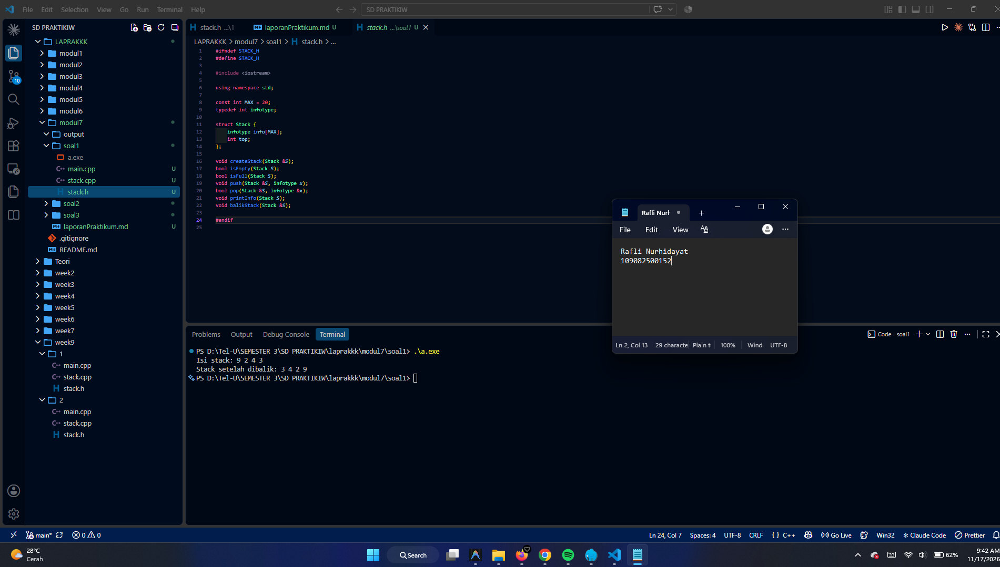
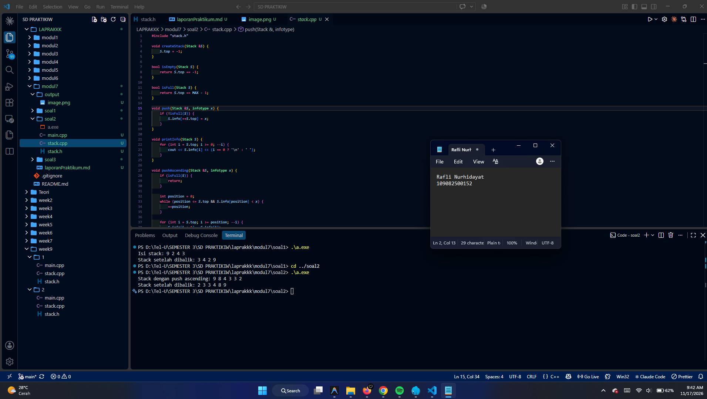
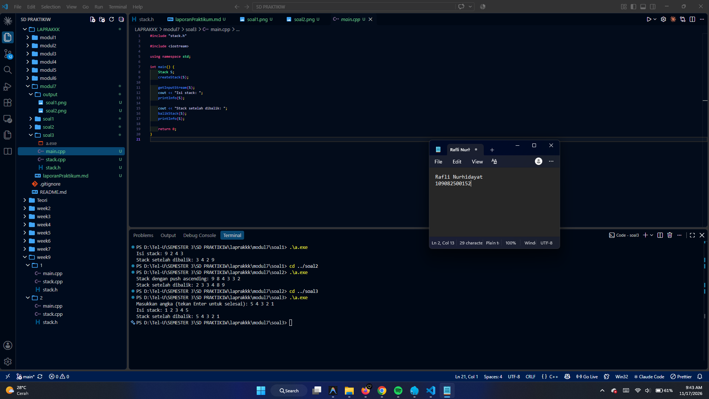

<div align="center">

# **Laporan Praktikum Modul 7 - Stack**

Rafli Nurhidayat - 109082500152

</div>

## Dasar Teori

Stack adalah struktur data linear yang menerapkan prinsip **LIFO (Last In,
First Out)**. Elemen yang terakhir dimasukkan menjadi elemen pertama yang
diambil. Contoh stack dalam kehidupan sehari-hari adalah tumpukan piring,
karena piring yang terakhir diletakkan berada pada posisi paling atas dan
diambil terlebih dahulu [1].

### A. Komponen Stack

Komponen utama stack adalah `Top`, yaitu penunjuk atau indeks yang menunjukkan
elemen paling atas. Berbeda dengan linked list biasa yang dapat mengakses
beberapa posisi, operasi utama stack hanya dilakukan pada bagian `Top`.
Stack kosong ditandai dengan `Top` yang belum menunjuk elemen, sedangkan stack
penuh ditentukan oleh batas kapasitas yang tersedia.

Operasi utama stack adalah:

1. **Push**, menambahkan elemen ke bagian atas stack.
2. **Pop**, mengambil dan menghapus elemen teratas stack.
3. **View**, menampilkan elemen stack dari atas ke bawah.
4. **Create**, menginisialisasi stack dalam keadaan kosong.

### B. Stack dengan Representasi Array

Pada representasi array, data stack disimpan dalam array berukuran tetap.
Variabel `top` menyimpan indeks elemen paling atas. Jika menggunakan indeks
berbasis nol, stack kosong dapat direpresentasikan dengan `top = -1`.
Operasi `push` menaikkan `top` terlebih dahulu, kemudian menyimpan data pada
indeks tersebut. Operasi `pop` mengambil data pada `top`, lalu menurunkan
nilainya.

Representasi array tidak membutuhkan alokasi dan dealokasi node secara
dinamis, tetapi memiliki kapasitas maksimum. Jika `top == MAX - 1`, stack
berada dalam keadaan penuh dan push tidak boleh dilakukan.

### C. Stack dengan Representasi Pointer

Pada representasi pointer, setiap elemen stack disimpan dalam node yang
memiliki data dan pointer `next`. Pointer `top` menunjuk node paling atas.
Push dilakukan dengan menambahkan node di awal rantai, sedangkan pop
dilakukan dengan memindahkan `top` ke node berikutnya dan menghapus node
sebelumnya.

Representasi pointer dapat bertambah selama memori masih tersedia, tetapi
memerlukan pengelolaan memori menggunakan `new` dan `delete`. Representasi
array lebih sederhana untuk kapasitas tetap, sedangkan representasi pointer
lebih fleksibel terhadap jumlah elemen [2].

### D. Kondisi Stack

Stack memiliki dua kondisi khusus:

- **Underflow**, yaitu keadaan ketika pop dilakukan pada stack kosong.
- **Overflow**, yaitu keadaan ketika push dilakukan pada stack penuh.

Pengecekan kondisi tersebut penting agar program tidak membaca data yang
tidak valid atau menulis data di luar batas array. Fungsi `isEmpty` digunakan
untuk mendeteksi underflow, sedangkan `isFull` digunakan untuk mendeteksi
overflow.

### E. Pembalikan Stack

Pembalikan stack mengubah urutan elemen dari atas ke bawah menjadi kebalikan
urutannya. Pada representasi array, pembalikan dapat dilakukan dengan
menukar elemen pertama dan terakhir, kemudian bergerak menuju bagian tengah.
Operasi ini tidak mengubah jumlah elemen dan memiliki kompleksitas waktu
`O(n)`.

### F. Push Ascending dan Input Stream

`pushAscending` merupakan variasi push yang menempatkan data pada posisi yang
menjaga urutan nilai stack. Saat elemen baru dimasukkan, elemen yang lebih
besar atau lebih kecil dapat digeser untuk menyediakan posisi yang sesuai.
Operasi ini membutuhkan pergeseran elemen sehingga kompleksitas terburuknya
`O(n)`.

`getInputStream` membaca input pengguna sampai tombol Enter ditekan. Setiap
input yang diterima kemudian dimasukkan ke dalam stack. Prosedur ini
menunjukkan bahwa stack dapat dibangun dari aliran input, bukan hanya dari
nilai yang ditulis langsung di dalam program.

## Guided

### 1. Guided Stack Representasi Array

**`stack.h`**

```cpp
#ifndef STACK_TABLE
#define STACK_TABLE
#include <iostream>
using namespace std;
const int MAX = 10;

struct stackTable
{
    int data[MAX];
    int top;
};
bool isEmpty(stackTable s);
bool isFull(stackTable s);
void createStack(stackTable &s);
void push(stackTable &s, int angka);
void pop(stackTable &s); 
void update(stackTable &s, int posisi);
void view(stackTable s);
void searchData(stackTable s, int data);
#endif
```

**`stack.cpp`**

```cpp

#include "stack.h"
#include <iostream>
using namespace std;

bool isEmpty(stackTable s)
{
    return s.top == -1;
}
bool isFull(stackTable s)
{
    return s.top == MAX - 1;
}
void createStack(stackTable &s)
{
    s.top = -1;
}
void push(stackTable &s, int angka)
{

    if (isFull(s))
    {
        cout << "Stack penuh!" << endl;
    }
    else
    {
        s.top++;
        s.data[s.top] = angka;
        cout << "Data" << angka << "berhasil ditambahkan kedalam stack !" << endl;
    }
}

void pop(stackTable &s)
{
    if (isEmpty(s))
    {
        cout << "Stack kosong!" << endl;
    }
    else
    {
        int val = s.data[s.top];
        s.top--;
        cout << "Data" << val << " berhasil dihapus dari stack!" << endl;
    }
}

void update(stackTable &s, int posisi)
{
    if (isEmpty(s))
    {
        cout << "Stack kosong!" << endl;
    }
    if (posisi <= 0)
    {
        cout << "Posisi tidak valid!" << endl;
        return;
    }
    // index = top

    int idx = s.top - (posisi - 1);
    if (idx < 0 || idx > s.top)
    {
        cout << "Posisi " << posisi << " tidak valid!" << endl;
        return;
    }

    cout << "Update data posisi ke-" << posisi << endl;
    cout << "Masukkan angka : ";
    cin >> s.data[idx];
    cout << "Data berhasil diupdate!" << endl;
    cout << endl;
}

void view(stackTable s)
{
    if (isEmpty(s))
    {
        cout << "Stack kosong!" << endl;
    }
    else
    {
        for (int i = s.top; i >= 0; --i)
        {
            cout << s.data[i] << " ";
        }
    }
    cout << endl;
}

void searchData(stackTable s, int data)
{
    if (isEmpty(s))
    {
        cout << "Stack kosong!" << endl;
        return;
    

    cout << "Mencari data " << data << "..." << endl;
    int posisi = 1;
    bool found = false;

    for (int i = s.top; i >= 0; --i)
    {
        if (s.data[i] == data)
        {
            cout << "Data " << data << " ditemukan pada posisi ke-" << posisi << endl;
            cout << endl;
            found = true;
            break;
        }
        posisi++;
    }

    if (!found)
    {
        cout << "Data " << data << " tidak ditemukan didalam stack!" << endl;
        cout << endl;
    }
}
```

**`main.cpp`**

```cpp
#include "stack.h"
#include <iostream>

using namespace std;

int main()
{
    stackTable s;
    createStack(s);

    push(s, 1);
    push(s, 2);
    push(s, 3);
    push(s, 4);
    push(s, 5);
    cout << endl;

    cout << "--- Stack setelah push ---" << endl;
    view(s);
    cout << endl;

    pop(s);
    pop(s);
    cout << endl;

    cout << "--- Stack setelah pop 2 kali ---" << endl;
    view(s);
    cout << endl;

    update(s, 2);
    update(s, 1);
    cout << endl;

    cout << "--- Stack setelah update ---" << endl;
    view(s);
    cout << endl;

    searchData(s, 4);
    searchData(s, 9);

    return 0;
}
```

### 2. Guided Stack Representasi Pointer

**`stack.h`**

```cpp
#ifndef STACK
#define STACK
#include <iostream>
using namespace std;

typedef struct node *address;
struct node {
    int dataAngka;
    address next;
};

struct stack {
    address top;
};  

bool isEmpty(stack listStack);
void createStack(stack &listStack);
address alokasi(int angka);
void dealokasi(address &node);

void push(stack &listStack, int nodeBaru);
void pop(stack &listStack);
void update(stack &listStack, int posisi);
void view(stack listStack);
void searchDta(stack listStack, int angka);
#endif
```

**`stack.cpp`**

```cpp
#include "stack.h"
#include <iostream>

using namespace std;

bool isEmpty(stack listStack)
{
    if (listStack.top == Nil)
    {
        return true;
    }
    else
    {
        return false;
    }
}

void createStack(stack &listStack)
{
    listStack.top = Nil;
}

address alokasi(int angka)
{
    address nodeBaru = new node;
    nodeBaru->dataAngka = angka;
    nodeBaru->next = Nil;
    return nodeBaru;
}

void dealokasi(address &node)
{
    node->next = Nil;
    delete node;
}

void push(stack &listStack, address nodeBaru)
{
    nodeBaru->next = listStack.top;
    listStack.top = nodeBaru;
    cout << "Node " << nodeBaru->dataAngka < " berhasil ditambahkan kedalam stack!" << endl;
}

void pop(stack &listStack)
{
    address nodeHapus;
    if (isEmpty(listStack) == true)
    {
        cout << "Stack kosong!" << endl;
    }
    else
    {
        nodeHapus = listStack.top;
        listStack.top = listStack.top->next;
        nodeHapus->next = Nil;
        dealokasi(nodeHapus);
        cout << "node " << nodeHapus->dataAngka << " berhasil dihapus dari stack!" << endl;
    }
}

void update(stack &listStack, int posisi)
{
    if (isEmpty(listStack) == true)
    {
        cout << "Stack kosong!" << endl;
    }
    else
    {
        if (posisi == 0)
        {
            cout << "Posisi tidak valid!" << endl;
        }
        else
        {
            address nodeBantu = listStack.top;
            int count = 1;
            bool found = false;
            while (nodeBantu != Nil)
            {
                if (count  posisi)
                {
                    nodeBantu = nodeBantu->next;
                    count++;
                }
                else if (count == posisi)
                {
                    cout << "Update node poisisi ke- << posisi << endl;
                    cout << "Masukkan angka : ";
                    cin >> nodeBantu>dataAngka;
                    cout << "Data berhasil diupdate!" << endl;
                    cout << endl;
                    found = true;
                    break;
                }
            }
            if (found == false)
            {
                cout << "Posisi " << posisi << " tidak valid!" << endl;
            }
        }
    }
}

void view(stack listStack)
{
    if (isEmpty(listStack) == true)
    {
        cout << "List kosong!" << endl;
    }
    else
    {
        address nodeBantu = listStack.top;
        while (nodeBantu != Nil)
        {
            cout << nodeBantu->dataAngka << " ";
            nodeBantu = nodeBantu->next;
        }
    }
    cout << endl;
}

void searchData(stack listStack, int data)
{
    if (isEmpty(listStack) == true)
    {
        cout << "List kosong!" << endl;
    }
    else
    {
        address nodeBantu = listStack.top;
        int posisi = 1;
        bool found = false;
        cout << "Mencari data "  data << "..." << endl;
        while (nodeBantu != Nil)
        {
            if (nodeBantu->dataAngka == data)
            {
                cout << "Data " << data << " ditemukan pada posisi ke-" << posisi << endl;
                found = true;
                cout << endl;
                break;
            }
            else
            {
                posisi++;
                nodeBantu = nodeBantu->next;
            }
        }
        if (found == false)
        {
            cout << "Data " << data << " tidak ditemukan didalam stack!" << endl;
            cout << endl;
        }
    }
}
```

**`main.cpp`**

```cpp
#include "stack.h"
#include <iostream>

using namespace std;

int main()
{
    stack listStack;
    address nodeA, nodeB, nodeC, nodeD, nodeE = Nil;
    createStack(listStack);

    nodeA = alokasi(1);
    nodeB = alokasi(2);
    nodeC = alokasi(3);
    nodeD = alokasi(4);
    nodeE = alokasi(5);

    push(listStack, nodeA);
    push(listStack, nodeB);
    push(listStack, nodeC);
    push(listStack, nodeD);
    push(listStack, nodeE);
    cout << endl;

    cout << "--- Stack setelah push ---" << endl;
    view(listStack);
    cout < endl;

    pop(listStack);
    pop(listStack);
    cout < endl;

    cout << "--- Stack setelah pop 2 kali ---" << endl;
    view(listStack);
    cout << endl;

    update(listStack, 2);
    update(listStack, 1);
    update(listStack, 4);
    cout << endl;

    cout << "--- Stack setelah update ---" << endl;
    view(listStack);
    cout << endl;

    searchData(listStack, 4);
    searchData(listStac, 9);

    return 0;
}
```

## Unguided

### 1. Soal 1 - Stack Dasar

Soal pertama mengimplementasikan operasi dasar stack menggunakan array, yaitu pembuatan stack, `push`, `pop`, `printInfo`, dan `balikStack`.

**`stack.h`**

```cpp
#ifndef STACK_H
#define STACK_H

#include <iostream>

using namespace std;

const int MAX = 20;
typedef int infotype;

struct Stack {
    infotype info[MAX];
    int top;
};

void createStack(Stack &S);
bool isEmpty(Stack S);
bool isFull(Stack S);
void push(Stack &S, infotype x);
bool pop(Stack &S, infotype &x);
void printInfo(Stack S);
void balikStack(Stack &S);

#endif
```

**`stack.cpp`**

```cpp
#include "stack.h"

void createStack(Stack &S) {
    S.top = -1;
}

bool isEmpty(Stack S) {
    return S.top == -1;
}

bool isFull(Stack S) {
    return S.top == MAX - 1;
}

void push(Stack &S, infotype x) {
    if (isFull(S)) {
        cout << "Stack penuh!" << endl;
        return;
    }

    ++S.top;
    S.info[S.top] = x;
}

bool pop(Stack &S, infotype &x) {
    if (isEmpty(S)) {
        return false;
    }

    x = S.info[S.top];
    --S.top;
    return true;
}

void printInfo(Stack S) {
    if (isEmpty(S)) {
        cout << "Stack kosong." << endl;
        return;
    }

    for (int i = S.top; i >= 0; --i) {
        cout << S.info[i];
        if (i > 0) {
            cout << " ";
        }
    }
    cout << endl;
}

void balikStack(Stack &S) {
    for (int left = 0, right = S.top; left < right; ++left, --right) {
        infotype temp = S.info[left];
        S.info[left] = S.info[right];
        S.info[right] = temp;
    }
}
```

**`main.cpp`**

```cpp
#include "stack.h"

#include <iostream>

using namespace std;

int main() {
    Stack S;
    int value;

    createStack(S);
    push(S, 3);
    push(S, 4);
    push(S, 8);
    pop(S, value);
    push(S, 2);
    push(S, 3);
    pop(S, value);
    push(S, 9);

    cout << "Isi stack: ";
    printInfo(S);

    cout << "Stack setelah dibalik: ";
    balikStack(S);
    printInfo(S);

    return 0;
}
```

### Output Unguided 1


Pada soal ini, data dimasukkan dan diambil mengikuti prinsip LIFO. Setelah dua kali `pop`, data teratas dihapus. `balikStack` kemudian menukar elemen dari kedua ujung array.

### 2. Soal 2 - `pushAscending`

Soal kedua menambahkan prosedur `pushAscending`. Setiap data baru ditempatkan pada posisi yang mempertahankan urutan nilai stack. Elemen yang berada di posisi penyisipan digeser terlebih dahulu.

**`stack.h`**

```cpp
#ifndef STACK_H
#define STACK_H

#include <iostream>

using namespace std;

const int MAX = 20;
typedef int infotype;

struct Stack {
    infotype info[MAX];
    int top;
};

void createStack(Stack &S);
bool isEmpty(Stack S);
bool isFull(Stack S);
void push(Stack &S, infotype x);
void printInfo(Stack S);
void pushAscending(Stack &S, infotype x);
void balikStack(Stack &S);

#endif
```

**`stack.cpp`**

```cpp
#include "stack.h"

void createStack(Stack &S) {
    S.top = -1;
}

bool isEmpty(Stack S) {
    return S.top == -1;
}

bool isFull(Stack S) {
    return S.top == MAX - 1;
}

void push(Stack &S, infotype x) {
    if (!isFull(S)) {
        S.info[++S.top] = x;
    }
}

void printInfo(Stack S) {
    for (int i = S.top; i >= 0; --i) {
        cout << S.info[i] << (i == 0 ? '\n' : ' ');
    }
}

void pushAscending(Stack &S, infotype x) {
    if (isFull(S)) {
        return;
    }

    int position = 0;
    while (position <= S.top && S.info[position] < x) {
        ++position;
    }

    for (int i = S.top; i >= position; --i) {
        S.info[i + 1] = S.info[i];
    }

    S.info[position] = x;
    ++S.top;
}

void balikStack(Stack &S) {
    for (int left = 0, right = S.top; left < right; ++left, --right) {
        infotype temp = S.info[left];
        S.info[left] = S.info[right];
        S.info[right] = temp;
    }
}
```

**`main.cpp`**

```cpp
#include "stack.h"

#include <iostream>

using namespace std;

int main() {
    Stack S;
    createStack(S);

    pushAscending(S, 3);
    pushAscending(S, 4);
    pushAscending(S, 8);
    pushAscending(S, 2);
    pushAscending(S, 3);
    pushAscending(S, 9);

    cout << "Stack dengan push ascending: ";
    printInfo(S);

    cout << "Stack setelah dibalik: ";
    balikStack(S);
    printInfo(S);

    return 0;
}
```

### Output Unguided 2


Penggunaan `pushAscending` membuat setiap pemasukan data membutuhkan pencarian posisi dan kemungkinan pergeseran elemen. Karena itu, kompleksitas terburuk operasi ini adalah `O(n)`.

### 3. Soal 3 - `getInputStream`

Soal ketiga menambahkan prosedur `getInputStream`. Program membaca karakter angka dari input pengguna dan memasukkannya ke stack sampai pengguna menekan Enter. Setelah input selesai, stack ditampilkan dan dibalik.

**`stack.h`**

```cpp
#ifndef STACK_H
#define STACK_H

#include <iostream>

using namespace std;

const int MAX = 20;
typedef int infotype;

struct Stack {
    infotype info[MAX];
    int top;
};

void createStack(Stack &S);
bool isEmpty(Stack S);
bool isFull(Stack S);
void push(Stack &S, infotype x);
void printInfo(Stack S);
void balikStack(Stack &S);
void getInputStream(Stack &S);

#endif
```

**`stack.cpp`**

```cpp
#include "stack.h"

void createStack(Stack &S) {
    S.top = -1;
}

bool isEmpty(Stack S) {
    return S.top == -1;
}

bool isFull(Stack S) {
    return S.top == MAX - 1;
}

void push(Stack &S, infotype x) {
    if (!isFull(S)) {
        S.info[++S.top] = x;
    }
}

void printInfo(Stack S) {
    for (int i = S.top; i >= 0; --i) {
        cout << S.info[i] << (i == 0 ? '\n' : ' ');
    }
}

void balikStack(Stack &S) {
    for (int left = 0, right = S.top; left < right; ++left, --right) {
        infotype temp = S.info[left];
        S.info[left] = S.info[right];
        S.info[right] = temp;
    }
}

void getInputStream(Stack &S) {
    cout << "Masukkan angka (tekan Enter untuk selesai): ";
    char input;
    while (cin.get(input) && input != '\n') {
        if (input >= '0' && input <= '9') {
            push(S, input - '0');
        }
    }
}
```

**`main.cpp`**

```cpp
#include "stack.h"

#include <iostream>

using namespace std;

int main() {
    Stack S;
    createStack(S);

    getInputStream(S);
    cout << "Isi stack: ";
    printInfo(S);

    cout << "Stack setelah dibalik: ";
    balikStack(S);
    printInfo(S);

    return 0;
}
```

### Output Unguided 3


Fungsi `getInputStream` menggunakan `cin.get()` agar proses pembacaan berlangsung karakter demi karakter. Karakter newline tidak dimasukkan ke stack dan digunakan sebagai penanda bahwa input telah selesai.

### 4. Kesimpulan Unguided

Ketiga soal berhasil mempraktikkan stack berbasis array secara bertahap. Soal pertama menerapkan operasi dasar LIFO, soal kedua mempertahankan urutan nilai melalui `pushAscending`, dan soal ketiga menerima data dari input stream. Semua operasi menggunakan indeks `top` dan tetap memperhatikan kapasitas maksimum array.

## Daftar Pustaka

[1] Telkom University, *Modul Praktikum Struktur Data: Stack*, Modul 7,
School of Computing, Telkom University.

[2] B. Stroustrup, *The C++ Programming Language*, 4th ed. Upper Saddle
River, NJ: Addison-Wesley, 2013.

[3] S. B. Lippman, J. Lajoie, and B. E. Moo, *C++ Primer*, 5th ed. Boston,
MA: Addison-Wesley, 2012.
