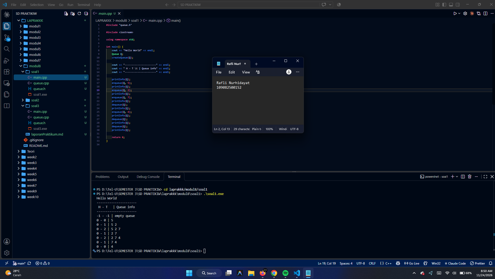
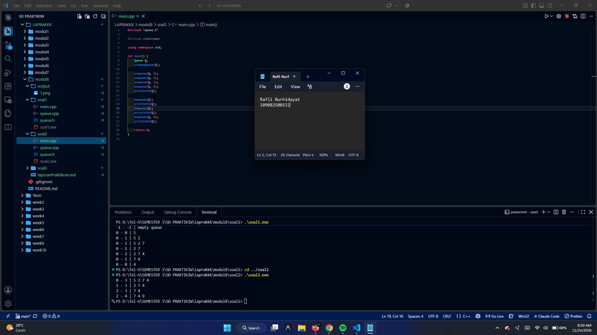
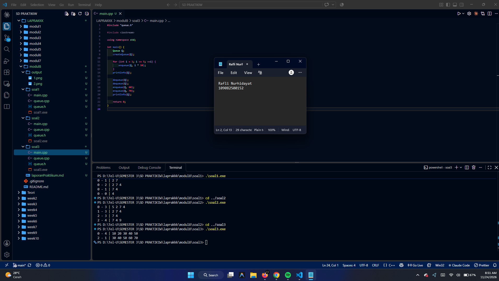

<div align="center">

# **Laporan Praktikum Modul 8 - Queue**

Rafli Nurhidayat - 109082500152

</div>

## Dasar Teori

Queue atau antrean merupakan struktur data linear yang menerapkan prinsip
**FIFO (First In, First Out)**. Elemen yang pertama kali dimasukkan merupakan
elemen yang pertama kali dikeluarkan [1]. Prinsip ini sama dengan antrean
pembelian tiket, loket pelayanan, atau printer. Orang yang datang paling awal
akan dilayani terlebih dahulu, sedangkan elemen baru ditempatkan di ujung
belakang antrean.

### A. Komponen Queue

Queue memiliki dua komponen utama, yaitu `head` dan `tail`. `Head` menunjuk
elemen paling depan atau elemen yang akan dikeluarkan pada operasi
`dequeue`. `Tail` menunjuk elemen paling belakang atau posisi terakhir tempat
elemen baru akan disisipkan pada operasi `enqueue`.

Pada queue yang menggunakan array, `head` dan `tail` dapat direpresentasikan
sebagai indeks array. Pada queue yang menggunakan linked list, `head`
menunjuk node pertama dan `tail` menunjuk node terakhir. Queue dapat
direpresentasikan dalam keadaan kosong dan keadaan satu atau lebih elemen.
Untuk array dengan indeks C++, queue kosong biasanya ditandai dengan
`head = -1` dan `tail = -1`.

### B. Operasi Queue

Operasi dasar pada queue adalah sebagai berikut [2]:

1. **CreateQueue** menginisialisasi queue agar berada dalam keadaan kosong.
2. **isEmptyQueue** memeriksa apakah queue tidak memiliki elemen.
3. **isFullQueue** memeriksa apakah seluruh kapasitas queue telah dipakai.
4. **Enqueue** menambahkan elemen baru pada bagian `tail`.
5. **Dequeue** menghapus dan mengambil elemen dari bagian `head`.
6. **PrintInfo** menampilkan elemen yang masih berada di dalam queue.

Enqueue pada queue penuh tidak boleh menulis di luar batas array. Sebaliknya,
dequeue pada queue kosong tidak boleh membaca atau menghapus elemen yang tidak
ada. Pengecekan ini mencegah overflow pada penambahan dan underflow pada
penghapusan.

### C. Queue Representasi Array

Pada representasi array, elemen disimpan dalam tabel berukuran tetap. Struktur
umum queue berisi array penyimpan dan dua variabel indeks. Kompleksitas waktu
untuk enqueue dan dequeue adalah `O(1)` pada kondisi ideal. Queue representasi
array menggunakan memori yang telah ditentukan sejak program dijalankan,
sehingga tidak memerlukan alokasi node. Namun, kapasitasnya terbatas.

Representasi array memiliki beberapa variasi implementasi [3]:

- **Alternatif 1**, `head` diam pada indeks depan dan `tail` bergerak. Dequeue
  dapat memerlukan pergeseran seluruh elemen agar elemen kedua menjadi
  elemen pertama.
- **Alternatif 2**, `head` dan `tail` bergerak. Setelah dequeue, `head`
  bertambah. Implementasi ini efisien, tetapi dapat menghasilkan keadaan
  penuh semu ketika `tail` mencapai indeks terakhir meskipun masih ada slot
  kosong di depan.
- **Alternatif 3**, `head` dan `tail` berputar secara circular. Jika salah satu
  mencapai indeks maksimum, indeks berikutnya kembali ke indeks awal.
  Representasi ini tidak memerlukan pergeseran elemen.

Pada alternatif 1, proses dequeue memindahkan semua elemen ke satu posisi
di depan. Operasi tersebut memiliki kompleksitas `O(n)`. Pada alternatif 2,
dequeue cukup menaikkan `head`, tetapi enqueue mungkin harus menggeser
elemen yang tersisa ke depan ketika `tail` mencapai kapasitas. Pada alternatif
3, operasi berjalan secara melingkar melalui modulo ukuran array.

### D. Perbandingan Queue Array dan Linked List

Queue array lebih mudah dipahami dan tidak membutuhkan penambahan atau
penghapusan node secara dinamis. Kekurangan utamanya adalah kapasitas tetap
dan potensi pemborosan memori pada representasi linear. Queue linked list dapat
bertambah selama memori masih tersedia, tetapi membutuhkan pengelolaan pointer
dan alokasi memori. Queue linked list cocok untuk jumlah elemen yang tidak
dapat dipastikan sebelumnya, sedangkan queue array cocok untuk kapasitas yang
tetap diketahui [4].

### E. Queue Circular

Pada queue circular, indeks terakhir dianggap bersebelahan dengan indeks
pertama. Fungsi successor digunakan untuk menentukan indeks berikutnya:

```text
successor(i) = (i + 1) mod ukuran_array
```

Dengan kondisi ini, indeks 4 dapat dilanjutkan ke indeks 0 pada array berukuran
5. Circular queue dapat memanfaatkan slot yang telah kosong. Agar kondisi
penuh dan kosong tidak tertukar, queue dapat menggunakan perbandingan
`(tail + 1) mod size == head`, atau dapat pula ditambah variabel `count`
untuk menyimpan banyaknya elemen [5].

## Guided

### 1. Guided Queue Representasi Linked List

Guided pertama mengimplementasikan queue menggunakan linked list. Setiap
node menyimpan satu string nama dan pointer `next`. `head` menunjuk node
paling depan, sedangkan `tail` menunjuk node paling belakang.

**`queue.h`**

```cpp
#ifndef QUEUE_H
#define QUEUE_H

#include <iostream>
#include <string>
using namespace std;
const int MaxQueue = 20;

struct Node {
    string nama;
    Node* next;
};

struct queue {
    Node *head, *tail;
};

void createQueue(queue &Q);
bool isEmpty(queue Q);
bool isFull(queue Q);
void enqueue(queue &Q, const string &nama);
void dequeue(queue &Q);
void viewQueue(queue Q);
void clearQueue(queue &Q);
#endif
```

**`queue.cpp`**

```cpp
#include "queue.h"

void createQueue(queue &Q){
    Q.head = NULL;
    Q.tail = NULL;
}

bool isEmpty(queue Q){
    return (Q.head == NULL && Q.tail == NULL);
}

bool isFull(queue Q){
    Node *nodeBantu = Q.head;
    int count = 0;
    while(nodeBantu != NULL){
        count++;
        nodeBantu = nodeBantu->next;
    }
    return (count >= MaxQueue);
}

void enqueue(queue &Q, const string &nama){
    if(isEmpty(Q)){
        Node *nodeBaru = new Node{nama, NULL};
        Q.head = nodeBaru;
        Q.tail = nodeBaru;
    }else {
        Node *nodeBantu = new Node{nama, NULL};
        Q.tail->next = nodeBantu;
        Q.tail = nodeBantu;
    }
}

void dequeue(queue &Q){
    if(isEmpty(Q)){
        cout << "Queue kosong!" << endl;
    } else {
        Node *nodeHapus = Q.head;
        Q.head = Q.head->next;
        if(Q.head == NULL){
            Q.tail = NULL;
        }
        delete nodeHapus;
    }
}

void viewQueue(queue Q){
    if(isEmpty(Q)){
        cout << "Queue kosong!" << endl;
    } else {
        Node *nodeBantu = Q.head;
        while(nodeBantu != NULL){
            cout << "Nama : " << nodeBantu->nama << " ";
            nodeBantu = nodeBantu->next;
        }
        cout << endl;
    }
}

void clearQueue(queue &Q){
    while(!isEmpty(Q)){
        dequeue(Q);
    }
}
```

**`main.cpp`**

```cpp
#include "queue.h"
#include <iostream>
using namespace std;

int main (){
    queue Q;
    createQueue(Q);

    enqueue(Q, "Dominic");
    enqueue(Q, "Torr");
    enqueue(Q, "Retto");
    enqueue(Q, "Letty");
    enqueue(Q, "Brian");
    enqueue(Q, "Mia");
    cout << "Isi Queue sebelum di dequeue: " << endl;
    viewQueue(Q);
    dequeue(Q);
    dequeue(Q);
    dequeue(Q);
    dequeue(Q);
    cout << "Isi Queue setelah di dequeue: " << endl;
    viewQueue(Q);
    return 0;
}
```

Pada guided ini, queue dimulai kosong. Setiap enqueue membuat node baru dan
menyambungkannya dari `tail` lama. Jika queue kosong, node baru sekaligus
menjadi `head` dan `tail`. Pada dequeue, node paling depan dihapus dan
`head` dipindahkan ke node berikutnya. Jika setelah penghapusan tidak ada node
lagi, `tail` dikembalikan menjadi `NULL`.

### 2. Guided Queue Representasi Array

Guided kedua mengimplementasikan queue dalam array berukuran lima. Sumber
menunjukkan tiga alternatif melalui fungsi yang diberi komentar. Implementasi
aktif menggunakan alternatif 1 untuk enqueue dan dequeue.

**`queue.h`**

```cpp
#ifndef QUEUE_H
#define QUEUE_H

#include <iostream>
using namespace std;

const int MAKSIMAL = 5;

struct queue {
    string nama[MAKSIMAL];
    int head;
    int tail;
};

bool isFull(queue Q);
bool isEmpty(queue Q);
void CreateQueue(queue &Q);
void enQueue(queue &Q, const string &nama);
void deQueue(queue &Q);
void viewQueue(queue Q);
void clearQueue(queue &Q);

#endif
```

**`queue.cpp`**

```cpp
#include "queue.h"
#include <iostream>

using namespace std;

bool isEmpty(queue Q){
    if(Q.head == -1 && Q.tail == -1){
        return true;
    } else {
        return false;
    }
}

bool isFull(queue Q){
    if(Q.tail == MAKSIMAL - 1){
        return true;
    } else {
        return false;
    }
}

void CreateQueue(queue &Q){
    Q.head = -1;
    Q.tail = -1;
}

void enQueue(queue &Q, string nama){
    if(isFull(Q) == true){
        cout << "Queue sudah penuh!" << endl;
    } else {
        if(isEmpty(Q) == true){
            Q.head = Q.tail = 0;
        } else {
            Q.tail++;
        }
        Q.nama[Q.tail] = nama;
        cout << "nama " << nama << " berhasil ditambahkan kedalam queue!" << endl;
    }
}

void deQueue(queue &Q){
    if(isEmpty(Q) == true){
        cout << "Queue kosong!" << endl;
    } else {
        cout << "Mengahapus data " << Q.nama[Q.head] << "..." << endl;
        for(int i = 0; i < Q.tail; i++){
            Q.nama[i] = Q.nama[i+1];
        }
        Q.tail--;
        if(Q.tail < 0){
            Q.head = -1;
            Q.tail = -1;
        }
    }
}

void viewQueue(queue Q){
    if(isEmpty(Q) == true){
        cout << "Queue kosong!" << endl;
    } else {
        for(int i = Q.head; i <= Q.tail; i++){
            cout << i - Q.head + 1 << ". " << Q.nama[i] << endl;
        }
    }
    cout << endl;
}
```

**`main.cpp`**

```cpp
#include "queue.h"
#include <iostream>

using namespace std;

int main(){
    queue Q;

    CreateQueue(Q);
    enQueue(Q, "Dimas");
    enQueue(Q, "Arvin");
    enQueue(Q, "Rizal");
    enQueue(Q, "Hafizh");
    enQueue(Q, "Fathur");
    enQueue(Q, "Daffa");
    cout << endl;

    cout << "--- Isi Queue Setelah enQueue ---" << endl;
    viewQueue(Q);
    cout << endl;

    deQueue(Q);
    deQueue(Q);
    deQueue(Q);
    deQueue(Q);
    cout << endl;

    cout << "--- Isi Queue Setelah deQueue ---" << endl;
    viewQueue(Q);

    return 0;
}
```

Pada alternatif aktif, enqueue menaikkan `tail` dari -1 menjadi 0 pada elemen
pertama. Dequeue menggeser semua elemen ke posisi sebelumnya, lalu menurunkan
`tail`. Cara ini membuat queue linear selalu dimulai dari indeks `head = 0`,
tetapi pergeseran data pada setiap dequeue menyebabkan biaya operasi lebih
tinggi.

## Unguided

### 1. Soal 1 - Alternatif 1: `Head` Diam dan `Tail` Bergerak

**`queue.h`**

```cpp
#ifndef QUEUE_H
#define QUEUE_H

typedef int infotype;
const int MAX_QUEUE = 5;

struct Queue {
    infotype info[MAX_QUEUE];
    int head;
    int tail;
};

void createQueue(Queue &Q);
bool isEmptyQueue(Queue Q);
bool isFullQueue(Queue Q);
void enqueue(Queue &Q, infotype x);
infotype dequeue(Queue &Q);
void printInfo(Queue Q);

#endif
```

**`queue.cpp`**

```cpp
#include "queue.h"

#include <iostream>

using namespace std;

void createQueue(Queue &Q) {
    Q.head = -1;
    Q.tail = -1;
}

bool isEmptyQueue(Queue Q) {
    return Q.head == -1 && Q.tail == -1;
}

bool isFullQueue(Queue Q) {
    return Q.tail == MAX_QUEUE - 1;
}

void enqueue(Queue &Q, infotype x) {
    if (isFullQueue(Q)) {
        cout << "Antrean penuh!" << endl;
        return;
    }

    if (isEmptyQueue(Q)) {
        Q.head = 0;
        Q.tail = 0;
    } else {
        ++Q.tail;
    }
    Q.info[Q.tail] = x;
}

infotype dequeue(Queue &Q) {
    infotype result = -1;
    if (isEmptyQueue(Q)) {
        cout << "Antrean kosong!" << endl;
        return result;
    }

    result = Q.info[Q.head];
    for (int i = Q.head; i < Q.tail; ++i) {
        Q.info[i] = Q.info[i + 1];
    }

    --Q.tail;
    if (Q.tail < 0) {
        Q.head = -1;
        Q.tail = -1;
    }
    return result;
}

void printInfo(Queue Q) {
    cout << Q.head << " - " << Q.tail << " | ";
    if (isEmptyQueue(Q)) {
        cout << "empty queue";
        cout << endl;
        return;
    }

    for (int i = Q.head; i <= Q.tail; ++i) {
        cout << Q.info[i];
        if (i < Q.tail) {
            cout << " ";
        }
    }
    cout << endl;
}
```

**`main.cpp`**

```cpp
#include "queue.h"

#include <iostream>

using namespace std;

int main() {
    cout << "Hello World" << endl;
    Queue Q;
    createQueue(Q);

    cout << "----------------------" << endl;
    cout << " H - T \t | Queue info" << endl;
    cout << "----------------------" << endl;

    printInfo(Q);
    enqueue(Q, 5); printInfo(Q);
    enqueue(Q, 2); printInfo(Q);
    enqueue(Q, 7); printInfo(Q);
    dequeue(Q); printInfo(Q);
    enqueue(Q, 4); printInfo(Q);
    dequeue(Q); printInfo(Q);
    dequeue(Q); printInfo(Q);

    return 0;
}
```

**Output**



Pada alternatif 1, nilai `head` tetap 0 selama queue berisi elemen. Fungsi
`enqueue` mengecek queue penuh berdasarkan `tail == 4`. Jika queue kosong,
`head` dan `tail` diset ke 0. Jika tidak kosong, `tail` bertambah satu.

Fungsi `dequeue` mengambil elemen pada indeks 0, kemudian menggeser semua
elemen dari belakang ke depan. Misalnya, setelah menghapus 5 dari array
`[5, 2, 7]`, elemen 2 dipindahkan ke indeks 0 dan elemen 7 dipindahkan ke
indeks 1. Setelah itu `tail` berkurang satu. Karena elemen harus digeser,
proses dequeue pada alternatif ini memiliki kompleksitas waktu `O(n)`.

Fungsi `printInfo` menampilkan pasangan `head - tail` dan seluruh elemen
yang masih valid. Ketika `tail` menjadi -1, queue dikembalikan ke keadaan
kosong dengan `head = -1` dan `tail = -1`.

### 2. Soal 2 - Alternatif 2: `Head` dan `Tail` Bergerak

**`queue.h`**

```cpp
#ifndef QUEUE_H
#define QUEUE_H

typedef int infotype;
const int MAX_QUEUE = 5;

struct Queue {
    infotype info[MAX_QUEUE];
    int head;
    int tail;
};

void createQueue(Queue &Q);
bool isEmptyQueue(Queue Q);
bool isFullQueue(Queue Q);
void enqueue(Queue &Q, infotype x);
infotype dequeue(Queue &Q);
void printInfo(Queue Q);

#endif
```

**`queue.cpp`**

```cpp
#include "queue.h"

#include <iostream>

using namespace std;

void createQueue(Queue &Q) {
    Q.head = -1;
    Q.tail = -1;
}

bool isEmptyQueue(Queue Q) {
    return Q.head == -1 && Q.tail == -1;
}

bool isFullQueue(Queue Q) {
    return Q.tail == MAX_QUEUE - 1;
}

void enqueue(Queue &Q, infotype x) {
    if (!isEmptyQueue(Q) && Q.tail == MAX_QUEUE - 1 && Q.head > 0) {
        int count = 0;
        for (int i = Q.head; i <= Q.tail; ++i) {
            Q.info[count] = Q.info[i];
            ++count;
        }
        Q.head = 0;
        Q.tail = count - 1;
    }

    if (isFullQueue(Q)) {
        cout << "Antrean penuh!" << endl;
        return;
    }

    if (isEmptyQueue(Q)) {
        Q.head = 0;
        Q.tail = 0;
    } else {
        ++Q.tail;
    }
    Q.info[Q.tail] = x;
}

infotype dequeue(Queue &Q) {
    infotype result = -1;
    if (isEmptyQueue(Q)) {
        cout << "Antrean kosong!" << endl;
        return result;
    }

    result = Q.info[Q.head];
    ++Q.head;
    if (Q.head > Q.tail) {
        Q.head = -1;
        Q.tail = -1;
    }
    return result;
}

void printInfo(Queue Q) {
    cout << Q.head << " - " << Q.tail << " | ";
    if (isEmptyQueue(Q)) {
        cout << "empty queue";
        cout << endl;
        return;
    }

    for (int i = Q.head; i <= Q.tail; ++i) {
        cout << Q.info[i];
        if (i < Q.tail) {
            cout << " ";
        }
    }
    cout << endl;
}
```

**`main.cpp`**

```cpp
#include "queue.h"

#include <iostream>

using namespace std;

int main() {
    Queue Q;
    createQueue(Q);

    enqueue(Q, 5);
    enqueue(Q, 2);
    enqueue(Q, 7);
    enqueue(Q, 4);
    printInfo(Q);

    dequeue(Q);
    printInfo(Q);
    dequeue(Q);
    printInfo(Q);
    enqueue(Q, 9);
    printInfo(Q);

    return 0;
}
```

**Output**



Pada alternatif 2, `head` bertambah pada setiap `dequeue`. Elemen lama tidak
perlu digeser satu per satu. Sebagai contoh, setelah menghapus 5, `head`
berubah dari 0 menjadi 1 dan elemen yang dapat diambil berikutnya adalah 2.

Pergeseran hanya diperlukan jika `tail` telah mencapai indeks akhir dan masih
tersedia posisi kosong di depan queue. Kondisi semacam ini disebut penuh
semu. Sebelum menambah elemen baru, elemen yang tersisa digeser ke indeks
awal, lalu `head` diset kembali ke 0 dan `tail` disesuaikan. Dengan cara
ini, slot depan dapat digunakan kembali meskipun array belum pernah diisi
ulang secara melingkar.

Jika seluruh elemen telah didequeue, `head` akan melewati `tail`, sehingga
fungsi mengembalikan keduanya ke -1. Queue kemudian kembali dalam keadaan
kosong. Dequeue pada alternatif ini lebih efisien daripada alternatif 1
karena tidak menggeser elemen pada setiap penghapusan.

### 3. Soal 3 - Alternatif 3: `Head` dan `Tail` Berputar

**`queue.h`**

```cpp
#ifndef QUEUE_H
#define QUEUE_H

typedef int infotype;
const int MAX_QUEUE = 5;

struct Queue {
    infotype info[MAX_QUEUE];
    int head;
    int tail;
};

void createQueue(Queue &Q);
bool isEmptyQueue(Queue Q);
bool isFullQueue(Queue Q);
void enqueue(Queue &Q, infotype x);
infotype dequeue(Queue &Q);
void printInfo(Queue Q);

#endif
```

**`queue.cpp`**

```cpp
#include "queue.h"

#include <iostream>

using namespace std;

void createQueue(Queue &Q) {
    Q.head = -1;
    Q.tail = -1;
}

bool isEmptyQueue(Queue Q) {
    return Q.head == -1 && Q.tail == -1;
}

bool isFullQueue(Queue Q) {
    return (Q.tail + 1) % MAX_QUEUE == Q.head;
}

void enqueue(Queue &Q, infotype x) {
    if (isFullQueue(Q)) {
        cout << "Antrean penuh!" << endl;
        return;
    }

    if (isEmptyQueue(Q)) {
        Q.head = 0;
        Q.tail = 0;
    } else {
        Q.tail = (Q.tail + 1) % MAX_QUEUE;
    }
    Q.info[Q.tail] = x;
}

infotype dequeue(Queue &Q) {
    infotype result = -1;
    if (isEmptyQueue(Q)) {
        cout << "Antrean kosong!" << endl;
        return result;
    }

    result = Q.info[Q.head];
    if (Q.head == Q.tail) {
        Q.head = -1;
        Q.tail = -1;
    } else {
        Q.head = (Q.head + 1) % MAX_QUEUE;
    }
    return result;
}

void printInfo(Queue Q) {
    cout << Q.head << " - " << Q.tail << " | ";
    if (isEmptyQueue(Q)) {
        cout << "empty queue";
        cout << endl;
        return;
    }

    int i = Q.head;
    while (true) {
        cout << Q.info[i];
        if (i == Q.tail) {
            break;
        }
        cout << " ";
        i = (i + 1) % MAX_QUEUE;
    }
    cout << endl;
}
```

**`main.cpp`**

```cpp
#include "queue.h"

#include <iostream>

using namespace std;

int main() {
    Queue Q;
    createQueue(Q);

    for (int i = 1; i <= 5; ++i) {
        enqueue(Q, i * 10);
    }
    printInfo(Q);

    dequeue(Q);
    dequeue(Q);
    enqueue(Q, 60);
    enqueue(Q, 70);
    printInfo(Q);

    return 0;
}
```

**Output**



Alternatif 3 menggunakan modulo agar `head` dan `tail` kembali ke indeks 0
setelah melewati indeks terakhir. Pada enqueue, posisi baru dihitung
`(tail + 1) mod 5`. Pada dequeue, posisi baru dihitung
`(head + 1) mod 5`. Dengan demikian, struktur array diperlakukan sebagai
lingkaran.

Queue dinyatakan penuh jika posisi sesudah `tail` sama dengan `head`.
Queue dinyatakan kosong jika `head` dan `tail` kembali bernilai -1. Setelah
dua dequeue pada contoh, `head` menjadi 2 dan dua slot awal dianggap kosong.
Enqueue 60 dan 70 mengisi indeks 0 dan 1 sehingga urutan yang ditampilkan
tetap dari 30, 40, 50, 60, 70. Output mencatat keadaan `head = 2` dan
`tail = 1`, yang menunjukkan bahwa tail telah berputar melewati indeks akhir
array.

### 4. Kesimpulan Unguided

Ketiga alternatif menghasilkan queue FIFO, tetapi memproses elemen dengan
cara berbeda. Alternatif 1 sederhana tetapi melakukan pergeseran pada setiap
dequeue. Alternatif 2 menghindari pergeseran pada dequeue, tetapi dapat
mengalami penuh semu sehingga kadang harus menggeser elemen yang tersisa.
Alternatif 3 paling efisien untuk array karena enqueue dan dequeue dapat
bergerak melingkar tanpa memindahkan semua elemen.

## Daftar Pustaka

[1] Weis, Mark Allen. *Data Structures and Algorithm Analysis in C++*. Boston:
Pearson, 2014.

[2] Goodrich, Michael T., Roberto Tamassia, dan David Mount. *Data Structures
and Algorithms in C++*. Hoboken: Wiley, 2011.

[3] Malik, D. S. *Data Structures Using C++*. 2nd ed. Boston: Cengage Learning,
2010.

[4] Telkom University. *Modul Praktikum 8 - Queue*. Bandung: Laboratorium
Pemrograman, 2025.

[5] Knuth, Donald E. *The Art of Computer Programming, Volume 1:
Fundamental Algorithms*. 3rd ed. Boston: Addison-Wesley, 1997.
